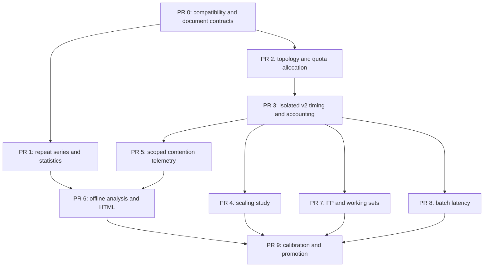

# ServerBench benchmark improvements: research and implementation design

**Status:** implementation-ready design. PR 0 is implemented; later PRs remain planned. See [implemented contracts](../result-contracts.md).  
**Prepared:** 29 October 2026.  
**Audited baseline:** app 0.1.1, Git commit `2b78150c50762ed32edda40e693af8749196e539`, CPU contract `cpu-v1-experimental-1`.

This plan covers all seven proposed improvements and the empirical calibration needed before freezing a public benchmark. Numeric thresholds below are proposed engineering policies, not claims that current hardware has passed them. Commands marked **proposed** do not exist in app 0.1.1.

Companions: [sequenced implementation backlog](implementation-backlog.md) and [result/service contracts](result-formats.md). Existing [methodology](../methodology.md) and [version policy](../versioning.md) remain authoritative for historical results.

## 1. Decisions and priorities

| Subject | Decision | Priority | Contract impact |
|---|---|---|---|
| Repeatability | Fresh-process repeat series; descriptive summaries first; conditional exact median intervals | P0 | Repeating an unchanged v1 run preserves its contract; series has a new document format |
| Worker/topology policy | Physical-core representatives before siblings; ceil fractional quota; explicit capacity vs worker count | P0 | New CPU execution contract |
| Scaling | Separate mixed-workload study with repeated, counterbalanced worker counts | P1 | Separate diagnostic protocol; no CPU Index contribution |
| Contention evidence | Preserve scoped cgroup counters, PSI and process/worker CPU time | P1 | New execution profile for additional live collection; offline interpretation can read v1 |
| Workload coverage | Add exact-answer FP64 and fixed working-set variants as unscored diagnostics first | P2 | New workload identities; no silent additions to v1 |
| Short stalls/degradation | Fixed-batch latency mode with bounded histograms; offline sustained analysis | P1/P2 | Latency is separate and unscored; offline v1 analysis preserves v1 scores |
| Reports | Offline HTML, provenance, meaningful comparison warnings and explicit uncertainty | P0/P1 | Presentation/document changes; no score rewrite |
| Calibration | Controlled causal experiments, multi-machine repeats, native ARM64 and shared-VPS surveys | Release gate | No calibrated v2 index until this gate passes |

Implement compatibility and measurement validity before adding new normalized scores. Keep the existing v1 profile available and preserve historical readers. Preview results must be visibly uncalibrated.

### Follow-up from the Proxmox/QEMU VM test

Plan a compact default console view with phase/workload and elapsed/target time, without repeated resource columns. `--verbose` will select detailed live statistics; existing `--no-progress` will retain phase transitions and the final report, and `--quiet` will suppress routine output while results are still saved. This is a presentation change: collection, JSON and benchmark arithmetic remain identical. Today `--no-progress` already supplies phase-only output; `--verbose` currently adds hashes. The [CLI follow-up](implementation-backlog.md#cli-follow-up--compact-progress-and-verbose-details) defines the option matrix, implementation boundaries and acceptance tests.

Unknown governor/frequency/temperature values are consistent with guest interfaces/sensors being unavailable; do not invent host readings. Legacy v1 also conflates unlimited and unreadable cgroup limits, so an `unknown` quota is not proof of either a cap or unlimited resources. PR 2 must preserve and explain the distinction using explicit availability/limit states. Guest topology/capacity and guest cgroup visibility must never be presented as proof of dedicated physical host resources. See the [VM field guide](../../README.md#unknown-fields-inside-a-proxmoxqemu-vm).

## 2. What the code currently does

These are repository observations, not assumptions about a particular server.

| ID | Finding | Implementation location | Consequence |
|---|---|---|---|
| F01 | A workload runs once per single/multi phase; its distribution comes from one-second windows | `serverbench-cpu/src/lib.rs::Engine::measure_observed` | Window CV is not run-to-run repeatability |
| F02 | Workers use `floor(effective_capacity)`, minimum one | `serverbench-system/src/lib.rs::detect` | A 1.5-CPU quota gets one worker and cannot fully exercise that budget |
| F03 | Workers take the first allowed CPU IDs; no core/sibling placement order is built | `serverbench-cpu/src/lib.rs` | Restricted runs may pick SMT siblings before separate cores |
| F04 | Worker data is prepared on the coordinator before worker affinity | `serverbench-cpu/src/lib.rs` | First-touch placement is not owned by the executing worker |
| F05 | Cgroup telemetry keeps only the largest ancestor throttling delta | `serverbench-metrics/src/lib.rs::Sampler::sample` | Leaf/ancestor attribution and enforcement-period counts are lost |
| F06 | CPU usage describes the allowed CPU set; there is no worker CPU-time measurement or PSI | `serverbench-metrics/src/lib.rs` | Background activity and benchmark execution are not separated |
| F07 | The corpus is 64 KiB; SHA-256 is forced software; no FP workload exists | `serverbench-cpu/src/workloads.rs`, root `Cargo.toml` | Working-set and FP coverage are limited; crypto ISA acceleration is deliberately excluded |
| F08 | Existing throughput summaries filter short tail windows and equally weight accepted windows | `serverbench-cpu/src/lib.rs` | Preserve these semantics for v1; define any different v2 method explicitly |
| F09 | Five workload ratios have equal geometric-mean weight | `serverbench-score/src/lib.rs::workload_score` | Compression/decompression together have 40% of that mix; category weighting is not equal |
| F10 | Sustained degradation compares first/last thirds; only aggregate worker finish skew is retained | `serverbench-score/src/lib.rs::calculate`, CPU engine | Short stalls, intermediate change and slow individual workers can be hidden |
| F11 | Validation and comparison support one contract and one result model | `serverbench-score/src/lib.rs::validate_result`, report `load_result` | Dispatch/version isolation is a prerequisite for new profiles |
| F12 | Reports are console/JSON; duplicate copies are not flagged | `serverbench-report/src/lib.rs` | Identical files can be mistaken for distinct server measurements |
| F13 | Survey aggregation does not explicitly partition changing CPU allocations into separate cohorts | `serverbench-survey/src/lib.rs::survey` | A changed quota/topology can be mistaken for temporal instability |
| F14 | Resource updates already use an asynchronous bounded output queue | `serverbench-report/src/progress.rs` | Retain that property; do not add telemetry/output allocations to hot worker loops |

Existing strengths to retain: fixed vectors and reference hash, anonymous defaults, monotonic timing, raw samples, cgroup ancestry inspection, no host configuration changes, and local atomic result publication.

## 3. Compatibility and architecture decisions

### 3.1 Separate file format, execution protocol and scoring

- Preserve the v1 reader, reference, formulas, percentile definition and validation fixtures. Never recompute an old result under a new score model.
- Add a version-dispatching document reader. Missing `document_type` with `schema_version: 1` means the existing v1 result.
- New documents use `schema_version: 2` and an explicit type: `benchmark`, `repeat_series`, `scaling_study`, `latency_study`, or `comparison_report`.
- Separate `application_version`, `benchmark_schema_version`, `benchmark_contract_id`, `protocol_id`, and optional `score_model_id`. A diagnostic can share a workload without being score-compatible.
- Add `cpu-v2-preview-1` for the new execution policy. Its normalized score fields are `null`, with `score_status: uncalibrated`; raw measurements remain useful.
- Keep v1 as the default until a later explicit promotion. Proposed selector: `--profile cpu-v1` or `--profile cpu-v2-preview`. Reject incompatible overrides rather than quietly modifying v1.
- Preserve v1 execution paths while adding separate v2 modules. Do not refactor timed v1 code and change its behavior as a side effect of introducing v2. Use the pinned original v0.1.1 binary for strict historical execution comparisons.
- A preview protocol is immutable once distributed. Changing its constants requires `preview-2`, even before a public score freeze.

### 3.2 Shared components and new modules

| Module | Responsibility |
|---|---|
| `serverbench-core::documents` | Discriminated readers, typed capabilities, protocol identities and incomplete/invalid states |
| `serverbench-core::v2` | New result/phase/sample/allocation models; v1 types retained |
| `serverbench-system::allocation` / `topology` | Snapshot visible limits and deterministic CPU placement without setting host policy |
| `serverbench-cpu::v2` | Planned phases, fixed deadlines, per-worker counts/times and cancellation |
| `serverbench-metrics::pressure` / `cgroup` / `cpu_time` | Scoped optional observations and counter deltas |
| New `serverbench-analysis` crate | Repeat statistics, scaling/degradation analysis, compatibility and comparison evidence; no execution |
| New `serverbench-runner` crate | Single-run, repeat and study orchestration; keeps the existing survey crate from becoming a general runner |
| `serverbench-report::html` | Offline rendering from a validated report model |
| `serverbench-score::v1` / later `v2` | Contract-specific normalization; preview diagnostics never call v1 scoring |

Move orchestration out of `serverbench-survey` only after compatibility tests exist. This structural move must not change the legacy timed worker path. CLI remains an argument-to-service adapter.

### 3.3 Validity and comparison rules

Classify observations as `valid`, `incomplete`, `invalid`, or `unavailable`, with structured reason codes. A missing sensor does not invalidate CPU measurements; checksum failure does. Dynamic affinity/quota changes invalidate the affected scored phase but retain already completed raw work and evidence.

Build an explicit comparison key from contract, mode/durations, workload/dataset identities, timer/instrumentation policy, placement policy and compiler/build policy. Worker counts and hardware may differ for capacity comparisons. Changing a machine's allocation inside one repeat series requires a separate cohort. Mixed contracts can be shown side by side without aggregate percentages.

Source-file SHA-256 identifies an exact input. A second fingerprint over canonical run content, excluding label/price/path metadata, detects renamed copies of the same run. Duplicate inputs are flagged and are not counted as independent repetitions. A fingerprint is not a signature or an authenticity claim.

### 3.4 Authoritative v2 throughput accounting

The resource sampler must not become the sole source of throughput history. If the coordinator is descheduled, it cannot reconstruct the lost one-second boundaries from one later cumulative counter. Implement this explicitly in the new engine:

- Preallocate a private per-worker array of one-second completed-unit buckets for the configured phase duration. Memory is part of preflight. Define a v2 phase duration ceiling of 24h; longer research needs separate bounded streaming design, not unbounded arrays.
- Read one monotonic timestamp after each completed batch and reuse it for bucket selection and the next deadline decision. Initial buffers, barriers and clock probes stay outside the timed phase. Do not add two clock reads per batch for ordinary throughput.
- Bucket a batch by its completion timestamp against a shared phase origin. Preserve zero-completion windows as measured zero work. Counts finishing after the nominal deadline belong to an explicit tail and still enter actual-elapsed total throughput, not the nominal full-window distribution.
- Keep hot counters private; publish padded cumulative counters at window transitions for approximate live display. No per-batch shared cacheline updates or terminal calls. The final arrays, not live estimates, determine throughput statistics.
- Serialize authoritative throughput windows separately from resource samples, whose actual intervals and coverage can differ. A missing PSI/temperature sample remains missing; it is not a zero-throughput interval. Align traces by overlap in analysis.
- Assert that full-window units plus tail units equal the sum of completed worker units. Retain per-worker actual start/finish offsets and CPU time. Partial failed phases are not scored as complete.

This changes execution/accounting and belongs only to v2. Deterministic fake-clock tests and deliberately delayed sampler/output tests must prove that raw worker throughput buckets survive observer delays. These changes require pilot overhead measurements before any v2 freeze.

## 4. Repeated runs and uncertainty

### Research finding

There are different variation levels: adjacent samples, separate executions, machine/session effects and builds. Treating all one-second samples as independent trials overstates evidence. This distinction motivates the design, rather than importing a methodology tied to a managed-language VM. [Kalibera and Jones, *Rigorous Benchmarking in Reasonable Time*](https://kar.kent.ac.uk/33611/45/p63-kaliber.pdf).

Distribution-free median intervals can use ordered independent observations and binomial tail probabilities. Their coverage is discrete and depends on sampling assumptions. Three observations cannot provide a finite two-sided 95% interval using their extreme order statistics. [Berkeley: confidence intervals for a population median](https://www.stat.berkeley.edu/pub/users/stark/SticiGui/Text/confidenceIntervals.htm).

### Implementation decision

**Proposed:** `benchmark --repeat 3 --repeat-pause 60s --label "server-a" --output results/server-a-series.json`.

1. Default remains one run and the existing single-result behavior. Accepted count is 1–100; explicit N=1 also retains single-result behavior. A repeat-specific pause requires N>=2.
2. Execute each child as a fresh process with the same immutable profile/options, fresh preflight, full normal idle and warm-up phases. For v1 the child uses the unchanged single-run CLI path. Pass arguments as an argument vector, never shell text.
3. Save each child result immediately in a sibling series directory. The manifest lists relative child paths, hashes, attempt order, status, timestamps, fixed pause, allocation signature and protocol options.
4. Default pause is 60 monotonic seconds between runs. No temperature-driven adaptive stop/cooldown: differing sensor availability must not change the protocol. Three full runs take roughly 26m45s plus initialization.
5. Stop after the first failed child by default, preserve partial results and exit 1. `--continue-on-error` may complete all attempts but must still report failures. Interrupted children receive graceful cancellation, are joined/reaped, and are never included as completed runs.
6. Aggregate per-run scores and per-workload medians. Do not pool seconds across runs, mix modes, or build a fictitious run by combining the best workload from different trials.
7. Report count, median, min/max, SD, CV and MAD of the run-level values. With three runs label these **observed repeatability**, not population confidence or future availability.
8. Partition or reject allocation changes; never average a four-worker and six-worker result as one unchanged-machine repeat cohort. Survey gets the same cohort analysis, while preserving its chronological records.

### Exact median intervals

Optional inferential analysis is requested explicitly, with a statement that runs are being treated as independent draws under reasonably stable conditions. The tool records that assumption; it cannot certify independence from a pause or lack of autocorrelation.

For sorted run-level values `x[1..n]`, choose the largest integer `k >= 1` such that:

```text
coverage(n,k) = 1 - 2 * sum(combination(n,j), j=0..k-1) / 2^n >= requested_coverage
interval = [x[k], x[n-k+1]]
```

Use a numerically stable binomial-tail recurrence for n up to 100; test against exact integer arithmetic. Report requested coverage and the binomial coverage bound: exact in the continuous IID model, conservative when ties make it larger. This is not a measured probability that an individual interval contains the unknown median. No interpolation of endpoints. If no finite interval is possible, return `null` and `insufficient_repeats`.

Golden cases: n=3 and n=5 cannot reach 95%; n=6 uses [min,max] with 96.875%; n=10 uses the 2nd/9th values with 97.8515625%; n=20 uses the 6th/15th values with 95.86105346679688%.

For a conservative comparison interval for `median(B)/median(A)`, require at least 10 valid, nonduplicate runs in each cohort and the explicit sampling assumption. Compute at least 97.5% median intervals for A and B; combine them as `[LB/UA, UB/LA]` when the denominators are positive. The union bound gives at least 95% joint coverage under the per-cohort sampling assumptions; independence between A and B is not required. Show ratio-of-medians, not mean-of-ratios. If median(A)=0 the point ratio is undefined. If median(A)>0 but LA=0, retain the point estimate and return an explicitly unbounded upper interval, not a fabricated finite limit. Negative scored values are invalid inputs.

An interval including 1 means the available evidence does not resolve the direction. An interval outside 1 supports a conditional statement about the measured protocol, not every workload or future VPS behavior. Do not use overlapping individual 95% intervals as a significance test. Do not attach these claims to three-run summaries or serial survey windows.

### Acceptance tests

- New-process tests prove every attempt starts a child and receives identical measured options; labels/output paths may differ.
- Crash, cancellation, missing child, duplicate file, duplicate payload with changed label, corrupt hash and resumed/manual manifests retain honest attempt counts.
- Golden median interval endpoints/coverage above, ties, constant values, n=100, zero scores, unbalanced cohort counts and nonfinite inputs.
- A synthetic series of duplicated 300-second traces still contributes only its distinct run count, never 300 independent observations.
- Survey records with changed limits remain chronological but split comparison cohorts.

## 5. CPU topology, placement and fractional quotas

### Research finding

The kernel exports logical topology and online CPU state; unsupported topology can use default/sentinel values. Exposed virtual topology is not a verified map of the physical hypervisor host. [Kernel topology documentation](https://docs.kernel.org/admin-guide/cputopology.html). Heterogeneous CPUs can also have different workload-dependent capacities; clock frequency alone does not identify equivalent cores. [Capacity-aware scheduling](https://docs.kernel.org/scheduler/sched-capacity.html).

Quota is a time budget per enforcement period, not a count of pinned CPUs. Several runnable workers may be needed to consume a fractional budget. [CFS bandwidth control](https://docs.kernel.org/scheduler/sched-bwc.html).

### Allocation model and policy

Store separate fields: `logical_cpus_visible`, `process_affinity_ids`, `effective_cpuset_ids`, `online_ids`, `allowed_ids`, `quota_cpu_equivalents`, `visible_capacity_cpu_equivalents`, `worker_count`, `placement_policy`, `actual_worker_cpu_ids`, and `visibility_complete`.

```text
allowed = affinity INTERSECT effective_cpuset_if_known INTERSECT online_if_known
C = min(len(allowed), minimum_visible_ancestor_quota_if_finite)
W = min(len(allowed), max(1, ceil(C)))
```

An unavailable quota is not asserted to be unlimited. Preserve scope/completeness. An empty allowed set aborts before allocating workers. A quota parse failure is distinct from a valid `max`/unlimited value.

| Allowed logical CPUs | Quota | Workers | Reported CPU-equivalent capacity |
|---:|---:|---:|---:|
| 8 | none visible | 8 | 8, visibility caveat if incomplete |
| 8 | 4.0 | 4 | 4.0 |
| 8 | 1.5 | 2 | 1.5 |
| 8 | 0.5 | 1 | 0.5 |
| 2 | 4.0 | 2 | 2.0 |

Use exact quota/period rationals for worker ceiling, not floating-point rounding near integer boundaries. Rational minima compare by checked cross-multiplication or reduced integer arithmetic; serialize both the rational and its display value.

### Placement algorithm

1. Read core sibling lists (`core_cpus_list`, fallback `thread_siblings_list`) and available package/die/core IDs. Intersect every group with allowed IDs.
2. Check sibling reciprocity, consistent IDs and complete membership. Negative IDs are unknown, not huge unsigned IDs. Contradictory/placeholder topology falls back to ascending allowed IDs with `topology_confidence: unknown`.
3. For valid exposed groups, sort deterministically by available node/package/die/core tuple, then lowest logical CPU ID. Select the lowest allowed representative from each core before adding second/third SMT siblings in rounds. No adaptive search for the fastest cores.
4. The initial policy is compact deterministic placement, not an undocumented NUMA optimizer. Record NUMA spread and known capacity classes. Do not invent P/E-core labels from MHz.
5. Workers pin and verify their actual affinity before allocating/touching private buffers. Preparation completes before the start barrier. Memory policy remains the kernel's default first-touch policy; no `mbind`, governor, priority or host settings change.
6. Snapshot allocation before each phase and verify again afterward. Hotplug, quota/cpuset change or failed required pin marks that phase invalid for the strict v2 profile. Save the reason and completed data. An explicitly unpinned diagnostic uses a different protocol identity.

Keep v1 `per_vcpu` semantics for old results. In v2 expose **per worker** and **per visible CPU-equivalent budget** separately. Neither is a prediction of the hypervisor's physical core performance.

### Acceptance tests

- Interleaved CPU IDs, SMT2/SMT4, cpuset with only one sibling, sparse IDs above 1023, multiple sockets/nodes, default `core_id=0`, negative IDs and inconsistent sibling masks.
- Integer and fractional quotas, near-integer rational boundaries, different ancestor periods, hidden ancestors, v1/v2 and quota greater than cpuset.
- Fixtures prove first physical representatives before siblings; runtime tests verify affinity is confined to allowed IDs and the caller's affinity is unchanged.
- Native ARM64, an exposed heterogeneous topology and virtual topology fixtures; no requirement that every platform expose capacity classes.
- Controlled lab check: isolated 1.5-CPU quota with at least two allowed CPUs can consume materially more than one CPU-equivalent using two workers. This is an execution-policy change and must never be assigned the old v1 contract.

## 6. Scaling curves

### Question and scope

Measure how delivered throughput changes with runnable workers under the same visible allocation. A curve can expose early saturation, SMT effects or bandwidth constraints, but it cannot identify a cause by shape alone. It is a diagnostic study, not an additional term in CPU Index.

**Proposed:** `serverbench scaling --profile cpu-v2-preview --workload mixed --trials 3 --output results/scaling.json`.

### Fixed initial protocol

- Workload: the existing five-batch mixed cycle, with its own diagnostic identity. FP/large-buffer variants do not silently enter that mix.
- Determine `Nmax` using the new quota-aware worker policy. Test the unique sorted set `{1, powers_of_two_up_to_Nmax, Nmax, visible_physical_core_count_if_between_1_and_Nmax}`.
- Baseline idle is 30s. Each measured point has 3s warm-up, 15s measurement and 10s recovery before the next point.
- Default is three trials. Order the non-one-worker points ascending, descending, then left-rotate their ascending order by one. This counterbalances a simple monotonic order without workload randomness.
- Every trial is `control_pre(N=1) + ordered_non_one_worker_points + control_post(N=1)`. Derive its N=1 point from those two controls, with no additional N=1 point inside the ordering. Controls measure drift, not extra independent trials. With counts [1,2,4,8], each trial has five measured phases.
- Store exact order, selected CPU IDs, point times, temperatures/frequencies, capacity and raw data. The initial protocol ID includes all durations and order rules. User overrides create a different comparison key.
- Print an estimated runtime before starting. Compute it from the actual point/order list, including controls, recovery and idle; do not promise a fixed time for every machine.
- Do not search all counts and select a hardware-specific optimum for the main benchmark. Report the observed peak count as a diagnostic.
- With only one available worker, return the baseline and `parallel_scaling_unavailable`; do not manufacture a scaling slope.

### Formulas

For each trial use the median of its bracketing one-worker controls as `T1`. The raw point is the median of full-window throughput for that point. Across trials report the median point and the individual trial values.

```text
speedup(N) = T(N) / T1
worker_efficiency(N) = T(N) / (T1 * N)
budget_factor(N,C) = min(N,C) / min(1,C)
budget_relative_efficiency(N,C) = T(N) / (T1 * budget_factor(N,C))
```

The budget formula avoids incorrectly expecting 2x throughput from a 1.5-CPU quota, and avoids double-normalizing the already quota-limited one-worker baseline below one CPU. A budget is a ceiling, not a reservation. These efficiencies can exceed 100% through frequency/cache effects or sampling variation; retain the value rather than clamp it.

Zero baseline produces `undefined_ratio`. More than 5% difference between the two controls produces `baseline_drift_observed`; still display the raw curve, but suppress confident bottleneck labels. Different capacity classes or NUMA placement are flagged as context for interpreting the model.

### Implementation and tests

Add `ScalingPlan`, `ScalingPoint`, `TrialControl` and `ScalingAnalysis` types in core/analysis; execute them through `serverbench-runner`, not the CLI. Reuse the v2 phase runner without updating the main scores.

Test Nmax=1,2,3,6,8; physical-core boundary insertion; duplicate point removal; all order lists; interrupted studies; changed allocation; zero baseline and drift flags. Numeric cases include C=0.5/N=1 giving budget factor 1, C=1.5/N=2 giving 1.5, C=4/N=4 giving 4. Preserve a slower final point: more workers are not required to improve throughput.

## 7. Contention evidence and resource accounting

### Research findings

PSI exposes resource stalls through system and cgroup pressure files. System CPU `full` is not a meaningful measurement and must not be interpreted as zero contention. [Linux PSI](https://docs.kernel.org/accounting/psi.html).

Current cgroup v2 documentation distinguishes ordinary enforcement counters from optional local runqueue throttling accounting. Feature-detect fields/files instead of assuming a kernel version, and retain ancestors separately. [Cgroup v2 CPU interfaces](https://docs.kernel.org/admin-guide/cgroup-v2.html#cpu).

Linux process CPU clocks account for all threads, while thread CPU clocks account for the calling thread. Wall time and CPU time answer different questions. [clock_gettime manual](https://man7.org/linux/man-pages/man3/clock_gettime.3.html).

### Data collection design

**v2 standard telemetry** samples once per second on a fixed monotonic grid. The observer never writes into a worker's hot loop. Keep raw counters plus deltas so analysis can be audited.

| Observation | Scope and treatment |
|---|---|
| `/proc/stat` CPU/steal | Allowed logical CPU set; not exclusive process utilization |
| Worker CPU time | Each worker reads its thread CPU clock at phase start/end; no per-batch syscall |
| Process CPU time | Process clock at phase/sample boundaries; includes sampler/output threads and must not be called worker-only time |
| `cpu.stat` | One record per visible cgroup ancestor: usage and enforcement counters, with optional burst fields |
| `cpu.stat.local` | Optional separate source/semantic label; never substitute it invisibly for ordinary counters |
| Cgroup v1 | Preserve source units; convert `throttled_time` from ns into the normalized time unit |
| System/cgroup PSI | CPU `some`, memory/IO `some` and meaningful `full`; record scope, totals and availability |
| Frequency/temperature | Optional context with sensor provenance; no direct causal or scoring role |

Records use ordinal scopes such as `leaf` and `ancestor_1`. Do not serialize absolute cgroup paths, task IDs or paths containing usernames/container IDs. The runtime may retain handles internally. Permission denied, unsupported, missing, malformed and counter-reset are distinct capability/reason states; unavailable is not zero.

For PSI totals, calculate `delta_stall_us / actual_interval_us * 100` for the same scope and resource. Keep source moving averages separately; do not relabel avg10 as an instantaneous one-second value. Validate domain and interval consistency. Missing/reset counters create a gap; do not interpolate it into a zero.

For bandwidth, retain `delta_nr_periods`, `delta_nr_throttled`, raw throttling duration and period/quota/burst configuration for every visible scope. Show enforcement-period fraction only for a positive valid period delta. Do not sum ancestor throttling durations or turn summed runqueue time into a wall-clock percent; parallel accounting can exceed wall duration.

Worker execution summaries:

```text
worker_cpu_equivalents = sum(worker_cpu_seconds) / phase_elapsed_seconds
worker_busy_fraction = worker_cpu_equivalents / worker_count
budget_delivery_ratio = worker_cpu_equivalents / min(worker_count, visible_capacity)
```

Ratios may slightly exceed one because of quota periods/burst/accounting windows. Preserve raw values and context rather than clipping them into a misleading utilization metric.

### Evidence-based observations

Start with transparent observations, not a classifier that promises a cause:

- `quota_enforcement_observed`: enforcement counters increased in a named visible scope. This can be expected when intentionally exercising a fractional quota; it is not automatically provider misbehavior or a reliability penalty.
- `steal_observed`: valid steal increased, with its measured scope and distribution.
- `cpu_pressure_observed`: CPU stall time increased. Saturating the machine can itself create pressure; this is insufficient to claim a noisy neighbour.
- `memory_pressure_observed`: pressure was measured during relevant phases; this does not establish its source.
- `throughput_decline_observed`: an offline defined sustained comparison found a decline.
- `thermal_correlation_only`: a decline overlaps rising visible CPU temperature or lower frequency. Without reliable hardware evidence, do not call it thermal throttling.
- `limited_visibility`: hidden ancestor/controller/sensor prevents a stronger conclusion.

Every observation lists supporting sample/phase IDs, rule version, thresholds and scope. All thresholds are display heuristics, not score inputs. A low worker CPU-time rate with zero steal can establish that less CPU time was received, but not which host-side cause produced it.

### Tests and overhead acceptance

Fixtures cover missing PSI, system CPU full=0, cgroup-only pressure, totals that reset, malformed decimals, cgroup namespaces, leaf/parent limits, optional local/burst fields, v1 ns versus v2 us and throttling duration above wall time. Rule tests must not label normal quota enforcement or benchmark-created pressure as noisy neighbours.

Record sampler/output CPU time, collection duration and dropped display updates. In a controlled diagnostic A/B study, measure minimal versus standard telemetry on both architectures: target under 0.5% of one core in observer CPU time and under 1% median throughput perturbation. These are gates to measure, not performance guarantees. If the bound cannot be supported, make the expensive source opt-in under a different diagnostic protocol; do not silently lower sampling frequency on slow machines.

Retain the existing asynchronous bounded output queue. Store JSON before waiting for terminal output. A blocked stderr test must leave measurement sampling and result persistence progressing.

## 8. Floating point and working-set coverage

### Research finding

Portable FP correctness requires explicit operation/rounding choices. Rust documents fused `mul_add` semantics and notes that several transcendental functions have unspecified precision. Avoid such functions for a cross-architecture bit-exact first workload. [Rust f64 documentation](https://doc.rust-lang.org/std/primitive.f64.html).

### FP64 diagnostic proposal

Add `fp64-matmul-dyadic-v1`, initially outside every CPU Index:

- 64x64 row-major matrix multiply, fixed loop order and fixed buffer ownership; no BLAS, runtime CPU dispatch, fast-math or `target-cpu=native`.
- Generate integer numerators in [-1024,1024] with a documented index formula, then divide by 1024. Inputs are exact binary fractions. Each dot product's exact integer numerator is bounded by `64 * 1024^2 = 2^26`, well within binary64 precision.
- Candidate formula, zero-based indices: `A_num[i,j] = ((131*i + 17*j + 3) % 2049) - 1024`; `B_num[i,j] = ((29*i + 73*j + 11) % 2049) - 1024`. Input serialization is all row-major A binary64 values followed by all B values, little-endian. Independently calculated candidate input SHA-256 is `4c9efda6966504f7d9f5277925fe15637afada2ec7fa3de13b42fd962b955b5a`; output SHA-256 is `676753965ec75d56108cd955662be9eafcc434ff5057bfb16c42be9edc330ae3`. These are design vectors, not an implemented/released workload. Reproduce them independently in the implementation PR.
- Use separate multiplication/addition expressions, finite normal-or-zero values and fixed operation counts. Do not call `mul_add`, sin/cos, exp/log or introduce denormals. This is a specified matrix-processing workload, not a claim of peak FPU throughput.
- Allocate inputs/output before timing, reset output at a specified point in each batch, black-box inputs/results and verify the full output with fixed known-answer bits/digest. Specify little-endian serialization for the digest. Verification cost is part of the timed batch and must be disclosed.
- Define one batch as one matrix multiplication; report batches/s and `2 * 64^3` nominal arithmetic operations per batch. Do not subtract guessed verification overhead from throughput.
- Produce an independent exact-integer implementation for expected output. Add native x86_64 and ARM64 execution, not just cross-compilation. Freeze dataset bytes, formula, output vector, operation count and verification path together.
- Pilot verification overhead and code generation before promotion. If this workload mostly measures verification/memory instead of useful FP work, revise its diagnostic identity and rerun the pilot rather than pretending the first design is calibrated.

### Fixed working-set diagnostics

Add 64 KiB, 1 MiB and 16 MiB input variants for compression, decompression and software SHA-256. Keep the 64 KiB v1 bytes unchanged. Define a versioned extension generator rather than assuming a new-size run shares the old workload identity. Keep data-processing's current record count unchanged in the first expansion; larger-record variants need their own generator and record schema.

These sizes test working-set sensitivity. Do not label them L1/L2/L3/DRAM benchmarks: real cache sizes, sharing and per-worker footprints differ. Record visible cache information as context when reliable. No cache flushes or privileged counters are required.

Use private per-worker inputs and buffers, created/touched after affinity in v2. Report input and total working-set bytes; do not assume input size equals compressor scratch space. A `ResourcePlan` declares input, worst-case output and scratch/verification bounds per workload before worker creation. Use fallible preallocation and a bounded-output codec path. If declared memory cannot fit available cgroup/system headroom with the configured reserve, mark the variant `skipped_insufficient_memory`; never silently reduce its size or worker count. A required scored variant being absent prevents that profile's score.

The first implementation keeps software SHA-256 as the portable baseline. Hardware-accelerated hashing can later be a separately identified diagnostic with actual backend metadata; do not mix accelerated and software results under one reference.

### Scoring decision

Do not add an FP score or average the new sizes into the existing index. The current five-way geometric mean gives compression/decompression two slots. A future v2 score must explicitly choose category versus workload/size weights before reference collection. The first candidate is equal category weights, with variants aggregated within their category; that is a calibration candidate, not a frozen formula. Publish the raw component ranking sensitivity and approve the score model only at the calibration gate.

### Acceptance tests

Independent golden FP vectors/digests, changed input/incorrect output rejection, finite/normal operand proofs, endian-independent digest construction and native architecture agreement. Compression roundtrips and exact output validation cover every size. Verify measured units, memory bounds, no timed I/O, and preflight rejection before a too-large allocation. A skipped optional variant stays visibly absent and cannot improve an aggregate by reducing its denominator.

## 9. Batch latency and sustained degradation

### Measurement question

One-second throughput windows cannot describe all shorter interruptions. Fixed-work batch completion times can characterize the benchmark's own completion jitter. They are not request latency under an offered application arrival rate; this closed-loop diagnostic does not justify web/API P99 claims.

HDR histograms provide bounded-range, configurable precision, allocation-free recording after preparation. The Rust API supports fixed bounds and returns errors outside them; clamping can hide extremes. [HdrHistogram design](https://hdrhistogram.github.io/HdrHistogram/) and [Rust API](https://docs.rs/hdrhistogram/latest/hdrhistogram/struct.Histogram.html).

### Separate latency protocol

**Proposed:** `serverbench latency --profile cpu-v2-preview --workload integer --duration 30s --output results/latency.json`.

1. Use the integer batch of exactly 32,768 iterations as the initial probe, not a hardware-calibrated variable amount of work. One-worker and quota-aware multi-worker phases are separate and identified.
2. Every worker reads a monotonic clock around the complete fixed batch, including specified correctness checks. Record wall completion time; phase-level thread CPU time remains a separate diagnostic.
3. Prepare a fixed-bounds per-worker `Histogram<u64>` with 1 ns low bound, 60s high bound and two significant decimal digits, using a pinned pure-Rust dependency. Disable auto-resize. No shared lock or output per batch.
4. Serialize histogram settings and recorded bin bounds/counts, total observations, zero/underflow/overflow counts, maximum actual duration and per-worker identity. Out-of-range values are counted explicitly, never clamped or discarded. Histograms are the raw distribution representation; their precision limit is disclosed.
5. Merge counts for the aggregate distribution. Never average worker percentiles. Also retain per-worker distributions to show an asymmetric worker.
6. Report median/P95 when at least 100 observations exist, P99 at 10,000 and P99.9 at 100,000. These are minimum display policies, not guarantees of tail accuracy or confidence. Otherwise return null and an insufficient-count reason. An overflow affecting a quantile makes it a bound/unavailable value, not an exact 60s observation.
7. Store clock resolution and an empty probe-pair cost distribution. Do not subtract its median from individual observations or publish zero/negative adjusted durations. If measured overhead is material, flag that workload as unsuitable for this diagnostic and design a new fixed batch identity.
8. Always set `instrumentation_mode: batch_latency`. This throughput cannot be used as a normal CPU Index input or compared as ordinary uninstrumented throughput. No coordinated-omission correction is applied without a separate specified arrival model.

### Offline sustained analysis

Add versioned analysis that can run on old v1 JSON without changing its saved Consistency/CPU Index:

- Use accepted full windows and preserve gaps. Compare equal-count early/late segments, each 20% of accepted windows, minimum five windows. If too short, report insufficient data. This new diagnostic does not replace v1's first/last-third formula.
- `decline = 1 - late_median / early_median` for a positive early median; otherwise undefined.
- For at least 30 accepted windows, compute 10-window rolling medians and flag a sustained lower regime when at least 10 successive rolling values are over 5% below the early reference. The 5%/10-window constants are diagnostic heuristics and carry an analysis version.
- Correlate in aligned, actually overlapping sample windows with steal, scoped enforcement, available frequency and temperature. Missing observations remain gaps. Do not infer causality from correlation.
- Preserve worker finish skew and expand v2 raw worker results with completion counts, CPU time, actual finish offset and status. A stopped/failed worker cannot quietly contribute partial throughput to a valid complete phase.

### Tests

Known synthetic histograms, merged versus per-worker counts, zero clock deltas, exactly-on-boundary and >60s observations, histogram saturation/counter overflow, insufficient quantile counts and cancellation. Reconstruct reported quantile bounds from serialized bins. Verify the backend cannot accidentally enable batch instrumentation in a scored core profile.

Synthetic sustained traces cover constant throughput, one isolated stall, gradual decline, late step-down, recovery, zero reference, missing sensor windows and a quota change. Separate an observed decline from any claimed thermal/hypervisor cause.

## 10. Offline HTML and better comparisons

### Deliverable and CLI

**Proposed:** `serverbench report server-a.json server-b.json --html comparison.html`.

Read existing/new documents through the same validated dispatch as console compare. Build one typed `ComparisonReport` in analysis, then feed console and HTML renderers; each renderer must not independently recalculate scores or compatibility. A single input produces a single-run/series report. Default is no network access and no browser launch; print the output path.

### Report contents

1. Full label, source filename, source hash, timestamp, app/compiler/target, execution/score protocol and calibration status.
2. Visible logical CPUs, worker count, CPU-equivalent quota, exposed topology, memory scope and changed/allocation caveats. Do not equate VM vCPUs with verified physical cores.
3. Score differences when compatible, raw per-workload comparisons where exact workload identities match, and precise reasons when a comparison is suppressed.
4. Repeat count/spread and any conditional intervals. Distinguish within-run window variation from between-run repeatability.
5. Throughput, steal, per-scope enforcement, PSI, available frequency and temperature traces on an elapsed-phase time axis. Preserve gaps; an unavailable sensor does not plot as zero degrees or zero pressure.
6. Scaling plots and batch-latency distributions when the corresponding study is supplied. Scored and instrumented results are visibly distinct.
7. Observations with their evidence windows, scope and heuristic version. No unsupported “noisy neighbour detected” or “thermal throttling proven” banner.
8. Duplicate-source warning, missing phases, histogram overflow, tail sample exclusions, changed capacity and validation errors.

### Rendering constraints

- Self-contained HTML/CSS/SVG and small embedded JavaScript for pan/zoom/toggling. No CDN, external fonts, analytics, remote images or requests. It must open from a local file under Linux or Windows browsers.
- Use `textContent` for user text. Escape HTML/attributes, and escape `<`, `>`, `&` and problematic separators in embedded JSON. Test a label containing a closing script tag; raw JSON serialization alone is not safe inside an HTML script element.
- Use a restrictive generated content policy for the static script/style and disable connections. Do not use labels as filenames or inject them into shell commands.
- Display-downsample only when needed: min/max-preserving buckets with gaps retained, maximum 4,000 plotted points per trace. Raw JSON and statistics are never downsampled or overwritten.
- Include accessible text tables with units and the full underlying extrema, not only chart hover interactions. Number formatting must not silently change percent/fraction units.
- Atomic report write, no existing-file overwrite by default. Embedded source-data export is a user-visible choice; reports can contain identifying labels and hardware metadata.

### Acceptance tests

Offline browser render with network blocked; labels with Unicode, quotes, HTML/script fragments and very long text; same labels/different files; identical source copies; v1/v2/profile mismatches; missing sensors; irregular resource intervals; histogram overflow and a partially completed study. Cross-check displayed numbers against JSON analysis objects. Downsampling must retain an isolated worst-throughput/maximum-steal point and never fill a missing interval.

Include one report fixture per document kind and comparison outcome. Generate browser screenshots during implementation review, including a narrow screen and a long-label case. No web dashboard, account or automatic upload is introduced.

## 11. Empirical validation and score calibration

### Questions that must be answered

The current normalized constants are chosen reference values, not a calibrated physical machine. More workloads and diagnostics cannot establish validity by themselves. The calibration program must test whether the measurement reacts correctly to known interventions, how much it varies, and what conclusions its sample design supports.

Benchmark reporting standards emphasize disclosed conditions and reproducibility. They are methodological references here, not a claim of SPEC compliance or a request to ship its proprietary workloads. [SPEC CPU run/reporting rules](https://www.spec.org/cpu2017/Docs/runrules.html). Fixed warm-up and explicit environment metadata are preferable to silently adapting measurement length until a convenient result appears. [pyperf reproducibility discussion](https://pyperf.readthedocs.io/en/stable/run_benchmark.html).

### Cohort and experiment matrix

| Experiment | Minimum useful setup | Evidence sought |
|---|---|---|
| Quiet repeatability | At least 10 full repeats on each controlled reference machine | Observed run-to-run spread; no significance claim based on seconds |
| Architectures | Intel x86_64, AMD x86_64 and native ARM64; two distinct systems per family before public freeze | Correctness and architecture-specific component behavior; not merely compile success |
| Host versus VM | Same physical host and comparable permitted CPU/memory allocations, run separately | Delivery differences with disclosed CPU feature exposure and placement |
| Fractional quotas | Isolated delegated groups at 0.5,1.0,1.5,2.0 CPU, plus a parent-limited child | Correct worker policy and quota/time accounting |
| Scheduler competition | Quiet control, same-core SMT competitor, separate-core competitor | Measured CPU time/throughput response without assuming a universal percentage |
| Quota period/burst | At least two enforcement periods and burst disabled/enabled where exposed | Correct raw counter interpretation and finite-window effects |
| Memory working sets | Comfortable memory, finite memory limit, unrelated memory pressure | Honest memory/resource coverage and no automatic workload shrink |
| Sustained behavior | 5m,10m and30m on selected machines under unchanged host policy | Early/late behavior, gaps, telemetry/throughput timing and long-run drift |
| Shared VPS | At least one actual shared VPS; preferably multiple providers/hosts | 24h full survey every2h, repeated on separate days; retain all timestamps |
| Instrumentation overhead | Controlled minimal/standard observer and batch-instrumented diagnostic comparisons | Observer CPU/memory cost and workload-specific perturbation |
| Missing visibility | VM without temperature/PSI, namespace-hidden ancestors, malformed fixtures | Unknowns remain unknown and cause appropriate limits on interpretation |

Your current VM-versus-dedicated comparison is useful initial evidence. It does not isolate virtualization overhead when physical hosts or allocated CPU counts differ. A paired host/guest study must match those conditions before attributing the gap to Proxmox/KVM.

The benchmark itself stays unprivileged and never creates quotas, competitors or thermal/governor changes. Controlled interventions belong to a separate explicitly operated lab harness; an administrator may need to delegate cgroups or configure the lab. No such interventions are run as part of this planning task.

### Protocol and analysis rules

- Archive exact executable hashes, contract/build manifests and all raw results. Keep manual lab notes separate from anonymous-by-default result metadata.
- Use fixed protocol durations and document chronological/counterbalanced order. Retain failed and noisy runs with reasons. Never choose only the fastest successful runs or tune a score to make a preferred server win.
- For quiet homogeneous reference controls, investigate run-level CV above 3% rather than automatically discard those observations. A variable real VPS is an intended finding, not a test failure to hide.
- Validate CPU-time delivery under isolated quota over at least 30s: target within 10% of the configured effective budget when the lab is otherwise quiet. Short-window bursts need not obey that ratio. Failures trigger inspection of visibility/accounting, not normalization of throughput upward.
- Require checksum agreement and no work lost from bucket/tail accounting on all tested architectures. Correctness gates are strict; proposed repeatability/overhead targets require empirical reports and may reveal an unsuitable protocol.
- Compare repeat summaries at the run level. An inference claim needs the sampling design/assumptions from section 4; a three-day survey does not automatically become an IID sample.
- Evaluate rankings with and without each workload/category and working-set variant. Publish sensitivity and correlations so adding closely related tests does not covertly dominate a category.
- Evaluate whether Consistency adds useful information beyond P10/median/CV and whether unavailable steal unfairly changes interpretations. Preserve the v1 formula; new calibrated weights require their own score model.

### Baseline selection and public freeze

First ship raw v2 preview diagnostics. Then select a disclosed reference from controlled, repeated component measurements and store absolute reference values permanently. Score 1000 is a normalization convention, not a statement that the chosen hardware is optimal or representative of every workload.

Before a scored v2 release, publish a calibration report containing cohort selection, exclusions/failures, component distributions, rank sensitivity, finalized category/variant weights, sustained mix/units, reference values and binary/build manifests. Add independently reproduced score vectors and compatibility tests. If reference selection or weights change, issue a new preview contract before collecting the final comparisons.

Promotion requires native architecture correctness, validated resource accounting, measured observer cost, sufficient repeatability evidence and explicit known limitations. A missing shared-VPS or native-ARM cohort blocks the public-standard claim, not continued raw diagnostic development. New public v2 scores are not numerically comparable with v1 indices; display them in separate comparison groups.

## 12. Cross-cutting acceptance and delivery rules

- Keep Linux x86_64/aarch64, no required root/container/runtime, offline workloads and no automatic upload.
- Preserve result files after failure/cancellation and expose partial status. Continue consistent existing exit codes: 2 configuration, 4 invalid result/checksum, 5 resource/precondition, 1 execution/partial-series failure.
- Do not run benchmarks during `info`, `compare`, `report` or offline analysis. Long execution requires an explicit benchmark/study command with a duration estimate.
- Add native ARM64 test execution to release validation, in addition to existing cross builds. Keep compilation flags/toolchain/dependency manifests explicit; avoid implicit ISA-native optimization.
- For this public repository, add a native `ubuntu-24.04-arm` CI lane for correctness/known-answer execution, keeping its performance observations out of calibration. GitHub documents that runner label in its [runner reference](https://docs.github.com/en/actions/how-tos/write-workflows/choose-where-workflows-run/choose-the-runner-for-a-job). Recheck runner availability when implementing the lane.
- Unit/fixture tests run in CI without host tuning. Privileged and multi-machine calibration jobs are opt-in external lab work, never requirements for ordinary pull-request CI.
- Golden legacy JSON must still validate and produce the same arithmetic scores after every PR. New data cannot be passed through the v1 scorer simply because field names happen to match.
- Release application changes separately from contract promotion. Publish the plan/backlog first; no new feature is considered implemented merely because its command appears in this document.

## 13. Recommended delivery order



Start collecting unchanged v1 control data after PR 0, not after all new features are written. Deliver repeatability and better reporting before promising a new index. Full file-level tasks and definitions of done are in [implementation-backlog.md](implementation-backlog.md).

## 14. Research sources and limits

Consulted on 29 October 2026. Kernel interfaces are feature-detected; documentation for a current kernel does not establish that an older VPS exposes every file. These sources inform the research findings. Default durations, thresholds, module boundaries and rollout policies in this plan are our proposed design decisions, not prescriptions claimed from those sources.

| Source | Used for |
|---|---|
| [Kalibera/Jones research](https://kar.kent.ac.uk/33611/45/p63-kaliber.pdf) | Repetition levels and uncertainty; the search-accessible paper abstract was available, but direct PDF retrieval timed out, so no detailed paper-specific algorithm is assumed |
| [Berkeley confidence intervals](https://www.stat.berkeley.edu/pub/users/stark/SticiGui/Text/confidenceIntervals.htm) | Binomial/order-statistic median intervals and interpretation |
| [Kernel CPU topology](https://docs.kernel.org/admin-guide/cputopology.html) | Exposed topology and unknown/default values |
| [Kernel capacity-aware scheduling](https://docs.kernel.org/scheduler/sched-capacity.html) | Heterogeneous capacity and workload dependence |
| [CFS bandwidth](https://docs.kernel.org/scheduler/sched-bwc.html) | Quota/period meaning, v1 accounting and hierarchy limits |
| [Cgroup v2](https://docs.kernel.org/admin-guide/cgroup-v2.html) | Optional scoped CPU interfaces and capabilities |
| [Kernel PSI](https://docs.kernel.org/accounting/psi.html) | Resource pressure scope and system CPU-full limitation |
| [Linux clocks](https://man7.org/linux/man-pages/man3/clock_gettime.3.html) | CPU-time clocks versus monotonic elapsed time |
| [Kernel procfs](https://docs.kernel.org/filesystems/proc.html) | System-visible CPU accounting and unreliable/resetting fields |
| [CPU frequency scaling](https://docs.kernel.org/admin-guide/pm/cpufreq.html) | Frequency/policy observations and interpretation limits |
| [Rust FP documentation](https://doc.rust-lang.org/std/primitive.f64.html) | Rounding/operation semantics and precision limitations; use APIs available in pinned Rust 1.85.1 |
| [HdrHistogram design](https://hdrhistogram.github.io/HdrHistogram/) and [Rust API](https://docs.rs/hdrhistogram/latest/hdrhistogram/struct.Histogram.html) | Bounded histogram configuration and explicit out-of-range behavior; dependency version must be pinned and MSRV-tested in its implementation PR |
| [SPEC reporting rules](https://www.spec.org/cpu2017/Docs/runrules.html) | Disclosure/reproducibility principles, not workload adoption or compliance |
| [pyperf reproducibility](https://pyperf.readthedocs.io/en/stable/run_benchmark.html) | Fixed measurement choices and sensitivity to environment; no system-tuning behavior is adopted |
